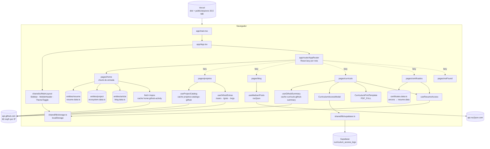
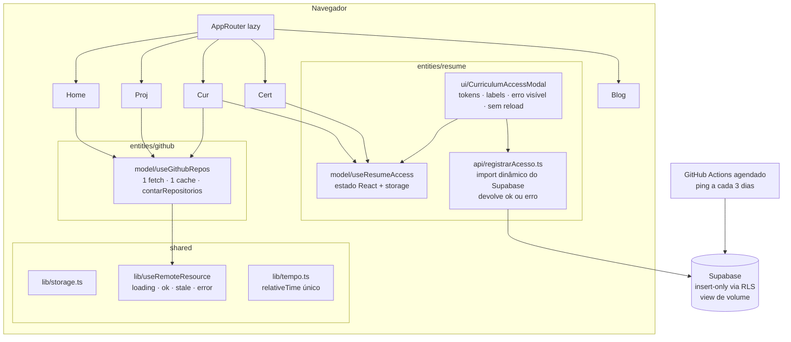

# Plano e arquitetura

Complementa o plano de ação do `Readme.md`. Os IDs `0.x` a `3.x` são os do README. Os novos são `A.x` (verificação do lote de 26/10), `1.6`, `2.10` a `2.13`, `3.5` e `P.x` (produto). Nada aqui foi implementado: este lote é só documentação.

---

## 1. Arquitetura atual

**Pontos de atenção no desenho atual:** três buscas independentes do mesmo `/repos`; o portão de acesso depende só do `localStorage`; o Supabase é importado de forma estática pelo modal.

## 2. Arquitetura alvo (sem mudar o produto)

---

## 3. Decisões (ADR curtos)

| ADR | Contexto | Decisão | Consequência |
|---|---|---|---|
| **ADR-01** FSD sem `features` e `widgets` | 56 arquivos, 5 entidades, 6 páginas | Manter `app` · `pages` · `entities` · `shared`. Criar `widgets/` só quando um bloco for usado por duas páginas | Menos camadas. O `SectionHead`, repetido em 3 páginas, é o primeiro candidato a `shared/ui` |
| **ADR-02** Classificação por topic do GitHub | Reclassificar sem abrir o editor | Mantida. `projects.data.ts` continua como segunda opção e fonte de texto | O arquivo de 753 linhas é mantido à mão: aceitar como enriquecimento, não como catálogo |
| **ADR-03** Números derivados, nunca digitados | "200+" em `resume.data.ts` contra 257 em `blog.data.ts` | `figures[].live` passa a aceitar `'artigos'`, lido de `blogMeta.mediumTotal`, e o texto de Publicações é montado a partir dele | Uma regra de teste pode proibir dígitos seguidos de "+" nos dados (proposta para o 1.2) |
| **ADR-04** Medição de acesso ao currículo | Regra do dono: o formulário existe para **medir volume** e fica. Hoje: laço com armazenamento bloqueado (E1), erro não detectado (E2), `reload`, cores literais, pausa do Supabase gratuito em 7 dias, e não há consulta documentada | Ver o detalhamento abaixo | O formulário continua igual para o visitante, a medição passa a ser confiável e o dono passa a ter como consultá-la. O Supabase **continua no navegador** |
| **ADR-05** Um recurso `/repos` por sessão | 3 hooks, 3 chaves e 3 totais | `entities/github/model/useGithubRepos` com uma chave e uma promessa compartilhada; `contarRepositorios()` único | Resolve o 2.9 e economiza até 2 requisições de 60 por hora |
| **ADR-06** Testes começam pelos dados | 161 registros, 257 artigos e um currículo mantidos à mão | Vitest em ambiente `node` para os dados; Testing Library e `jsdom` só a partir do 1.4 | Testes rápidos. O teste ganha `tsconfig.test.json` para não ficar sem checagem de tipos (1.6) |
| **ADR-07** Reformular o item 2.4 | A premissa ("210 kB em todas as páginas") venceu com o 2.1, e o objetivo contraria a regra do dono | O 2.4 deixa de ser "função serverless" e vira "import dinâmico do Supabase no envio" | Cerca de 210 kB brutos (estimativa) saem do carregamento inicial do Currículo, sem infraestrutura nova |

### ADR-04 em detalhe — medição de acesso ao currículo

| # | Aperfeiçoamento | Como | Por quê |
|---|---|---|---|
| 1 | Estado de acesso em React, com o storage como persistência | `useResumeAccess` com `useState(() => lerItem(...) === 'true')`; `grantAccess` atualiza o estado **e** grava. Exposto por um contexto leve ou por um evento, para Currículo e Certificados | Elimina o laço E1: com o storage bloqueado, o acesso vale para a sessão |
| 2 | Sem `window.location.reload()` | `onClose()` depois de `grantAccess`; a página rende o currículo pelo novo estado | Sem piscar, sem perder o scroll e sem gravar de novo |
| 3 | Erro detectado e visível | `const { error } = await supabase.from(...).insert(...)`. Com erro, a mensagem aparece no modal ("Não foi possível registrar agora. Tentar de novo?" e "Continuar sem registrar"). **Decisão do dono:** liberar mesmo assim ou exigir o registro | Hoje a falha nunca é vista (E2) |
| 4 | Uma gravação por sessão | Marca em `sessionStorage` (via `storage.ts`) e botão desabilitado enquanto envia | Volume sem duplicatas de reenvio |
| 5 | Tokens de tema e acessibilidade | `bg-surface-solid`, `border-default`, `text-primary`; `<label>` visível ou `sr-only`; `role="dialog"`, `aria-modal`, `aria-labelledby`; Esc fecha; foco no primeiro campo; `maxLength` de 60 e 80 | Coerência com o modo claro (2.5) |
| 6 | Import dinâmico | `const { supabase } = await import('@/shared/lib/supabase')` dentro do envio | Reformulação do 2.4 (ADR-07) |
| 7 | Origem do acesso | Coluna `origem` (`'curriculo'` ou `'certificados'`) e `created_at default now()` | Separa os dois portões. **Exige migração no Supabase: decisão do dono** |
| 8 | RLS | Política `insert` para `anon`; nenhuma `select` para `anon`; `check (char_length(first_name) <= 60 and char_length(company) <= 80)` | A chave anon é pública por desenho |
| 9 | Pausa do plano gratuito | Workflow agendado (`schedule: cron '0 9 */3 * *'`) que chama uma função `ping()` (`security definer`, `select 1`) pela REST, com a URL e a chave anon como *secrets* do GitHub. **Não gravar na tabela de log** | Sem acesso por 7 dias, o projeto pausa e as próximas gravações se perdem até a reativação manual |
| 10 | Como o dono consulta o volume | View `vw_acessos_curriculo_semana` (`date_trunc('week', created_at)`, `count(*)`, `count(distinct lower(company))`) consultada no SQL Editor do Supabase, salva como "Snippet". Opcional: exportar CSV mensal | Hoje não há forma documentada de ler o dado que o formulário existe para produzir |
| 11 | Teste | 1.3: `registrarAcesso` com cliente mockado devolvendo `{ error }`. 1.4: o fluxo com `localStorage` lançando exceção libera sem laço | Trava E1 e E2 |

---

## 4. Plano em lotes

Legenda — **Esforço:** P (até 1h), M (até meio dia), G (mais de meio dia). **Risco:** de quebrar algo. **Muda o produto?** Se o visitante vê diferença.

### Lote A — Verificar o lote de 26/10 (antes de qualquer outro)

| ID | Item | Motivo | Arquivos | Pronto quando | Esf. | Risco | Muda o produto? | Situação |
|---|---|---|---|---|---|---|---|---|
| A.1 | Rodar `npm install` e commitar o `package-lock.json` | O lock de 07/10 não tem `vitest` e mantém 6 pacotes removidos; o `npm ci` do CI falha | `package-lock.json` | Lock sem `chart.js`, `jspdf` etc.; `npm ci` limpo | P | Baixo | Não | Pendente |
| A.2 | Confirmar a versão do `vitest` | `^5.0.2` não foi verificado contra o registro nem contra o peer do Vite 8.1 | `package.json` | `npm install` sem `ETARGET` nem `ERESOLVE`; `npx vitest --version` responde | P | Médio | Não | Pendente |
| A.3 | Rodar `npm test` e `npm run build` com `strict` | O 23/09 mediu zero erro numa base anterior | — | 14 testes verdes; `tsc -b` sem erro | P | Baixo | Não | Pendente |
| A.4 | Roteiro manual de `05-testes-manuais.md` | Validar o tema, o portão e os títulos | — | Todas as caixas marcadas | M | — | Não | Pendente |
| A.5 | Commits separados por item (0.1, 0.2, 0.3, 0.4, 2.6, 2.8, docs), PR para `developer-mvp` | Regra do README: uma issue, um PR | — | CI verde no PR | P | Baixo | Não | Pendente |

### Fase 0 — Rede de segurança (README)

| ID | Item | Situação real em 27/10 |
|---|---|---|
| 0.1 | `strict: true` | Feito localmente, **sem commit**, não compilado (A.3) |
| 0.2 | `localStorage` protegido | Feito localmente, sem commit. **Introduziu o laço E1** no portão: tratar no 2.5 |
| 0.3 | CI | Feito localmente, sem commit. Falha até o A.1 |
| 0.4 | Integridade dos dados | Feito localmente, sem commit. 2 âncoras pendentes (P.6) |

### Fase 1 — Testes

| ID | Item | Motivo | Arquivos | Pronto quando | Esf. | Risco | Muda? | Situação |
|---|---|---|---|---|---|---|---|---|
| 1.1 | Testing Library e `jsdom` + teste de fumaça | Resto do 1.1 do README | `package.json`, `vite.config.ts` (`test.environmentMatchGlobs`) | 1 teste de render passa | P | Baixo | Não | Parcial |
| 1.2 | Funções puras: `resolverAncora`, `formato.ts`, `getFallbackImageFor`, `route`, `relativeTime` | README | `src/**/*.test.ts` | Caso feliz, borda e inválido | M | Baixo | Não | Pendente |
| 1.3 | Hooks de dado ao vivo + `registrarAcesso` | README + ADR-04 nº 11 | idem | Os 4 estados cobertos; `{ error }` cobre a E2 | M | Baixo | Não | Pendente |
| 1.4 | Fumaça por rota + portão com storage bloqueado | README + E1 | idem | 6 rotas renderizam; o portão libera sem laço | M | Baixo | Não | Pendente |
| 1.5 | Cobertura com piso | README | `ci.yml` | Relatório no PR | P | Baixo | Não | Pendente |
| **1.6** | `tsconfig.test.json` com `types: ["node","vitest/globals"]`, incluído nas `references` | E7: o teste não passa por checagem de tipos | `tsconfig.json`, novo `tsconfig.test.json` | `tsc -b` checa `src/**/*.test.ts` | P | Baixo | Não | Novo |

### Fase 2 — Performance, robustez e limpeza

| ID | Item | Motivo | Arquivos | Pronto quando | Esf. | Risco | Muda? | Situação |
|---|---|---|---|---|---|---|---|---|
| 2.2 | Hook único `useRemoteResource` | 6 erros de lint e 4 cópias | 4 hooks + `Curriculo.tsx` + `Home.tsx` | Lint com zero erro; tirar o `continue-on-error` | M | Médio | Não | Pendente |
| 2.3 | `Date.now()` fora do render | `useProjectCatalog.ts:226` | idem | Lint limpo | P | Baixo | Não | Pendente |
| 2.4 | **Reformulado (ADR-07):** import dinâmico do Supabase no envio | A premissa original venceu e o objetivo contraria a regra do dono | `CurriculumAccessModal.tsx` | O chunk do Currículo cai para cerca de 8 kB brutos (estimativa) e surge um chunk `supabase` sob demanda | P | Baixo | Não | Reformular no README |
| 2.5 | **Ampliado (ADR-04 nº 1–8):** estado React, sem `reload`, `{ error }` visível, uma gravação por sessão, tokens, `label`, `role="dialog"`, Esc, `maxLength` | E1, E2 e README | `useResumeAccess.ts`, `CurriculumAccessModal.tsx`, `Certificados.tsx`, `Curriculo.tsx` | Em janela anônima com cookies bloqueados libera sem laço; com Supabase fora do ar mostra o erro; modo claro correto | M | Médio | Sim, levemente (mensagem de erro) | Pendente |
| 2.5b | Ping contra a pausa e view de volume (ADR-04 nº 9–10) | Pausa de 7 dias; consulta do dono | `.github/workflows/supabase-ping.yml`, SQL no Supabase | Workflow verde; view retorna contagem semanal | P | Baixo | Não | Novo — exige o dono no Supabase |
| 2.6 | Faxina **ampliada**: `App.css` (não importado), 3 imagens (969 KB), `public/icons.svg`, 3 arquivos vazios, 2 órfãos | E10, E11 | listados | Build verde; `grep` sem referência quebrada | P | Baixo | Não | Parcial |
| 2.7 | WebP e tamanhos da Home + destaque sem `lazy` e com `fetchpriority="high"` | 1.155,8 kB; LCP | `src/assets/home/*`, `Home.tsx:223` | Home abaixo de 300 kB de imagem | M | Baixo | Não (visual igual) | Pendente |
| 2.8 | `og:image` + favicon próprio | Resto do 2.8; P.9 | `index.html`, `public/` | Prévia de link com imagem | P | Baixo | Sim | Parcial |
| 2.9 | **Ampliado (ADR-05):** `/repos` único e `contarRepositorios()` para Home, Currículo e Projetos | 3 totais e 3 buscas | `entities/github/model/useGithubRepos.ts` + 3 consumidores | As 3 telas mostram o mesmo número; 1 requisição por hora | M | Médio | Sim (o número muda em 1–2 telas) | Pendente |
| **2.10** | Contraste: `--color-text-muted` no escuro de `#71717a` para algo como `#8b8b94` (calculado: 5,89:1 sobre a página e 5,25:1 sobre `surface-solid`) | 4,12:1 e 3,67:1 | `main.css:14` | Todas as combinações de texto em AA 4,5:1 | P | Baixo | Sim (cinza mais claro) | Novo |
| **2.11** | Acessibilidade estrutural: `<main>` único, link "pular para o conteúdo", menu móvel com `inert` quando fechado e Esc | Seção 6 do relatório | `Curriculo.tsx:424`, `MainLayout.tsx`, `Sidebar.tsx` | Leitor de tela com 1 `main`; Tab não entra no menu fechado | P | Baixo | Não | Novo |
| **2.12** | Tema sem flash: script inline no `index.html` aplica `data-theme` antes do React; trocar o `* { transition }` por transição só durante a troca | Flash e custo | `index.html`, `main.css:57-59`, `ThemeToggle.tsx` | Recarregar no tema claro não pisca | P | Baixo | Não | Novo |
| **2.13** | 404 útil: link para a Home e o Currículo | `NotFound.tsx` | idem | — | P | Baixo | Sim | Novo |

### Fase 3 — Documentação

| ID | Item | Situação |
|---|---|---|
| 3.1 | ADRs em `docs/adr/` | Os ADRs curtos deste arquivo podem ser a semente |
| 3.2 | `docs/dados.md` | Pendente |
| 3.3 | `CONTRIBUTING.md` | Pendente |
| 3.4 | Reapurar o relatório | Pendente |
| **3.5** | Corrigir o README nos 10 pontos da seção 9 do `01-relatorio.md` | Novo — depende do A.1–A.3 |

### Produto (decisão do dono)

| ID | Proposta | Arquivo | Esforço | Muda o produto? |
|---|---|---|---|---|
| P.1 | Nome e cargo atual como título da Home; link "Currículo" na primeira dobra | `Home.tsx`, `ecosystem.data.ts` | P | Sim |
| P.2 | AmploPay detalhada no PDF | `CurriculumPrintTemplate.tsx:16-22` | P | Sim — conferir que o PDF segue com uma página |
| P.3 | "200+" → `blogMeta.mediumTotal` | `resume.data.ts:47,464` | P | Sim |
| P.4 | Revisar `blogClosing` | `blog.data.ts` | P | Sim |
| P.5 | Conferir os períodos da Estácio e do IF Sudeste | `resume.data.ts:381,388`; `certificates.data.ts` | P | Sim |
| P.6 | Corrigir as 2 âncoras | `certificates.data.ts` (`reg-ifsudestemg`, `reg-ufjf`) | P | Sim (os cards ganham período) |
| P.7 | Top Destaques antes dos boards | `Projetos.tsx` | P | Sim |
| P.8 | Linha de finalidade no formulário (LGPD) | `CurriculumAccessModal.tsx` | P | Sim |
| P.9 | Favicon próprio | `public/favicon.svg` | P | Sim |
| P.10 | "atualizações semanais" com fonte ou removido | `ecosystem.data.ts:86` | P | Sim |
| P.11 | Renomear `Resilia Conecta - 3 anos capacitando talentos.pdf` para o padrão `emissor-AAAAMMDD-titulo.pdf` | `public/arquivos/eventos`, `certificates.data.ts` | P | Não |
| P.12 | Botão flutuante de WhatsApp (já no README) | `MainLayout.tsx` | P | Sim |

**Ordem recomendada:** A.1 → A.5 · 2.5 + 2.5b (a medição é regra de negócio) · P.1–P.3 (maior impacto no público nº 1) · 1.6, 1.2–1.4 · 2.9, 2.10–2.13 · 2.2, 2.3, 2.4 · 2.6, 2.7 · Fase 3.
